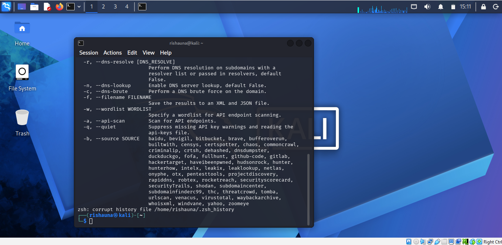

# NETWORKWALKS-B084-WK2-PM1-CYBERSECURITY-theHarvester-Zenmap

## 📌 Project Overview

This report presents the practical activities completed during Week 2 of my Cybersecurity and Ethical Hacking internship at Networkwalks. The activities covered two key areas: Footprinting & Reconnaissance with theHarvester (W2-PM1) and Zenmap-Based Network Scanning (W2-PM5).
The first activity focused on gathering publicly available information about the networkwalks.com domain using various Kali Linux reconnaissance tools, including theHarvester. The second activity involved using Zenmap, a graphical interface for Nmap, to scan my own local network and identify active hosts.
Both activities provided practical exposure to the initial stages of a cybersecurity assessment, from collecting information about a target domain to discovering devices on a network. This report documents the commands used, the results observed, supporting screenshots, and the significance of the findings from a cybersecurity perspective.

## 🎯 Objectives

The objective of this report is to demonstrate practical understanding of footprinting, reconnaissance, and network scanning using cybersecurity tools. Specifically, the activities aim to:
1. Use Kali Linux tools, including theHarvester, to gather publicly available information about the networkwalks.com domain.
2. Identify domain details, web technologies, DNS information, and other relevant information through reconnaissance.
3. Use Zenmap to scan my own local network and identify active hosts.
4. Interpret and document the results obtained from both practical activities.
5. Understand how footprinting and network scanning contribute to identifying potential security risks during the initial stages of a cybersecurity assessment.
6. Develop practical skills in using cybersecurity tools while ensuring all scanning activities are performed within an authorized environment.

## Task 1. Find email IDs & sub-domains related to a target organization microsoft.com
using the theHarvester tool in Kali Linux with Baidu. Set the limit of number of
results to 1000.

## Read the usage instructions & guidelines:

